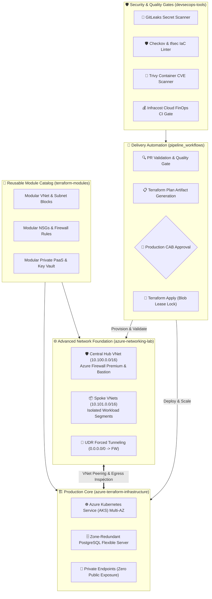

<div align="center">

<!-- Modern Cloud Native Organization Header Banner -->


# ☁️ Welcome to **CloudEngineeringHub**

### 🚀 **Open Platform Engineering, Modular Infrastructure as Code & Zero-Trust Cloud Architecture**

[+%26+Zero-Trust+Workload+Identity;Shift-Left+DevSecOps+Pipelines+(Checkov%2C+Trivy%2C+GitLeaks);Enterprise+Hub-and-Spoke+Networking+%26+Private+Endpoints;Standardized+CI%2FCD+Workflows+for+Azure+DevOps+%26+GitHub+Actions)](https://git.io/typing-svg)

<p align="center">
  <a href="https://github.com/CloudEngineeringHub"></a>
  <a href="#"></a>
  <a href="#"></a>
  <a href="#"></a>
  <a href="#"></a>
  <a href="#"></a>
</p>

<!-- Quick Navigation Bar -->
<p align="center">
  <a href="#-about-cloudengineeringhub"><b>About Us</b></a> •
  <a href="#-core-platform-engineering-pillars"><b>Core Pillars</b></a> •
  <a href="#-organization-ecosystem-architecture"><b>Architecture Map</b></a> •
  <a href="#-featured-repositories-directory"><b>Repositories</b></a> •
  <a href="#-production-engineering-standards"><b>Standards</b></a> •
  <a href="#-leadership--maintainers"><b>Maintainers</b></a>
</p>

---

### 🌐 *"Engineering Deterministic, Resilient & Audit-Ready Cloud Platforms Through Code, Security & Automation"*

</div>

<br/>

## 📖 About CloudEngineeringHub

**CloudEngineeringHub** is an open platform engineering initiative dedicated to architecting, packaging, and maintaining **production-grade enterprise cloud foundations on Microsoft Azure**.

Our mission is to bridge the gap between ad-hoc cloud provisioning and **deterministic, auditable, enterprise-scale platform engineering**. Every repository under this organization is designed to adhere strictly to:
- 🏛️ **Microsoft Cloud Adoption Framework (CAF)** and Azure Well-Architected Framework (WAF).
- 🔒 **Zero-Trust Security & CIS Azure Foundations Benchmarks v2.0**.
- ⚙️ **Declarative, Modular Infrastructure as Code (IaC)** with remote state locking and automated drift detection.
- 🔄 **Shift-Left DevSecOps Continuous Delivery** with integrated vulnerability scanning, policy enforcement, and FinOps budget guardrails.

---

## 🏛️ Core Platform Engineering Pillars

```
                           [ CloudEngineeringHub Platform Ecosystem ]
                                                │
         ┌──────────────────────────────┬───────┴───────┬──────────────────────────────┐
         ▼                              ▼               ▼                              ▼
 [ Modular IaC & Modules ]     [ Enterprise Network ]  [ DevSecOps & Governance ]  [ CI/CD Workflows ]
  • Parametric Blueprints       • Hub-and-Spoke CAF     • Shift-Left Security Scans • Multi-Stage YAML
  • Azure Blob State Locking    • Azure Firewall IDPS   • Checkov / tfsec / Trivy   • Approval PR Gates
  • Semantic Versioning         • UDR Forced Egress     • GitLeaks Secret Scanner   • Progressive Delivery
  • Zero Configuration Drift    • Private Link Perim    • Infracost FinOps CI       • Automated Rollbacks
```

- ☁️ **Enterprise Cloud Foundations:** Complete architectural blueprints for multi-tier workloads, multi-AZ Kubernetes (AKS) clusters, distributed caching, and zone-redundant databases.
- 🧩 **Standardized Terraform Modules:** Reusable, parameterized Terraform modules with strict input validation, outputs encapsulation, and isolated Azure Blob storage backend locking.
- 🛡️ **Zero-Trust DevSecOps:** Security is a continuous automated pipeline gate. We eliminate static credentials using Azure Workload Identity and Azure Key Vault CSI secret auto-rotation.
- 🌐 **Modern Network Architecture:** Non-overlapping RFC 1918 CIDR IPAM, Hub-and-Spoke virtual networks, Azure Firewall Premium deep packet inspection, and Private Link isolation.
- 🔄 **Production-Ready CI/CD Workflows:** Scalable pipeline definitions and reusable GitHub Actions / Azure DevOps templates with automated PR quality checks and blue-green deployments.

---

## 🗺️ Organization Ecosystem Architecture

The following diagram illustrates how the repositories within **CloudEngineeringHub** interconnect to form an end-to-end, enterprise-scale cloud engineering foundation:



---

## 📂 Featured Repositories Directory

<table width="100%">
  <thead>
    <tr>
      <th width="35%">Repository</th>
      <th width="45%">Description &amp; Key Architectural Features</th>
      <th width="20%">Tech Stack</th>
    </tr>
  </thead>
  <tbody>
    <tr>
      <td>
        <b>🏗️ <a href="https://github.com/CloudEngineeringHub/azure-terraform-infrastructure">azure-terraform-infrastructure</a></b>
      </td>
      <td>
        Enterprise production Azure infrastructure orchestrated via declarative Terraform. Implements multi-tier application architectures, multi-AZ AKS compute, zone-redundant storage, and Azure Blob remote state lease locking.
      </td>
      <td>
        <br/>
        <br/>
        
      </td>
    </tr>
    <tr>
      <td>
        <b>🛡️ <a href="https://github.com/CloudEngineeringHub/devsecops-tools">devsecops-tools</a></b>
      </td>
      <td>
        Comprehensive DevSecOps automation suite providing shift-left security scripts, CIS Azure Benchmark compliance checkers, Checkov/tfsec scanning configs, GitLeaks secret detection, and Trivy container vulnerability gates.
      </td>
      <td>
        <br/>
        <br/>
        
      </td>
    </tr>
    <tr>
      <td>
        <b>🌐 <a href="https://github.com/CloudEngineeringHub/azure-networking-lab">azure-networking-lab</a></b>
      </td>
      <td>
        Modular, hands-on enterprise networking lab implementing Hub-and-Spoke topology, Azure Firewall Premium with IDPS/TLS inspection, Azure Bastion zero-public-IP access, User-Defined Routes (UDR), and Private Link perimeters.
      </td>
      <td>
        <br/>
        <br/>
        
      </td>
    </tr>
    <tr>
      <td>
        <b>🧩 <a href="https://github.com/CloudEngineeringHub/terraform-modules">terraform-modules</a></b>
      </td>
      <td>
        Standardized, reusable, enterprise-grade Terraform modules published with semantic versioning. Covers VNets, Subnets, NSGs, AKS Nodepools, Azure SQL, Key Vault, and NAT Gateways with built-in input validation.
      </td>
      <td>
        <br/>
        <br/>
        
      </td>
    </tr>
    <tr>
      <td>
        <b>🔄 <a href="https://github.com/CloudEngineeringHub/pipeline_workflows">pipeline_workflows</a></b>
      </td>
      <td>
        Production-tested CI/CD pipeline definitions and reusable GitHub Actions / Azure DevOps workflows. Includes automated linting, security scanning, Infracost budget diffs, manual approval gates, and blue-green deployments.
      </td>
      <td>
        <br/>
        <br/>
        
      </td>
    </tr>
  </tbody>
</table>

---

## 🛡️ Production Engineering Standards We Enforce

Every codebase hosted under **CloudEngineeringHub** must adhere to the following non-negotiable engineering principles:

1. **Zero Out-of-Band Portal Changes:** 100% of cloud resources must be managed via declarative code. Nightly scheduled drift detection jobs trigger instant alerts if manual changes occur.
2. **Zero Plaintext Secrets:** Passwords, API tokens, and connection strings are strictly prohibited in repositories. Applications authenticate using Microsoft Entra ID Managed Identities and dynamic Azure Key Vault CSI secret rotation.
3. **Shift-Left Security as a PR Gate:** Pull requests are automatically blocked from merging if Checkov, tfsec, or Trivy detect High or Critical security vulnerabilities.
4. **FinOps Cost Consciousness:** Every infrastructure change PR includes an automated Infracost summary calculation showing the exact monthly financial impact before approval.
5. **High Availability & Disaster Recovery:** All production-grade architectures are designed with Multi-AZ redundancy and clear RTO (&lt; 15m) / RPO (&lt; 5m) disaster recovery runbooks.

---

## 👥 Leadership & Maintainers

**CloudEngineeringHub** was founded and is actively maintained by:

<div align="center">

<p align="center">
  <b>Neetu Patel</b><br/>
  <i>Senior DevOps Engineer &amp; Azure Cloud Platform Architect</i><br/>
  <a href="https://github.com/patelneetu10-stack"></a>
  <a href="https://linkedin.com/in/patelneetu10"></a>
  <a href="mailto:patel.neetu10@gmail.com"></a>
</p>

</div>

---

## 🤝 Contributing & Community

We welcome contributions, issues, and discussions from fellow DevOps and Cloud Engineers!

- 🐛 **Found a bug or drift issue?** Please open an issue in the respective repository.
- 💡 **Have an architecture suggestion?** Submit a PR following our standard branch protection and commit conventions.
- ⭐ **Support the initiative:** If you find these architectures and modules helpful, please leave a star on our repositories!

<br/>

<div align="center">

<!-- Modern Waving Footer -->


</div>
